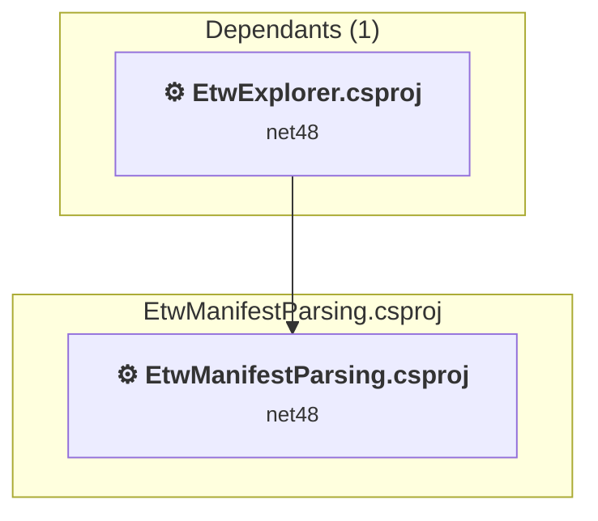

# EtwManifestParsing\EtwManifestParsing.csproj

[← Back to the assessment index](../../assessment.md)

## Project Info

- **Current Target Framework:** net48
- **Proposed Target Framework:** net11.0
- **SDK-style**: False
- **Project Kind:** ClassicClassLibrary
- **Dependencies**: 0
- **Dependants**: 1
- **Number of Files**: 8
- **Number of Files with Incidents**: 2
- **Lines of Code**: 678
- **Estimated LOC to modify**: 0+ (at least 0.0% of the project)

## Related Projects

**Depended on by (1)** — projects that reference this one:

- [C:\p\m\EtwExplorer\EtwExplorer\EtwExplorer.csproj](../projects/EtwExplorer.md)

## Dependency Graph

Legend:
📦 SDK-style project
⚙️ Classic project

## API Compatibility

| Category | Count | Impact |
| :--- | :---: | :--- |
| 🔴 Binary Incompatible | 0 | High - Require code changes |
| 🟡 Source Incompatible | 0 | Medium - Needs re-compilation and potential conflicting API error fixing |
| 🔵 Behavioral change | 0 | Low - Behavioral changes that may require testing at runtime |
| ✅ Compatible | 0 |  |
| ***Total APIs Analyzed*** | ***0*** |  |

## NuGet Package Issues

| Package | Current Version | Suggested Version | Severity | Issue |
| :--- | :---: | :---: | :---: | :--- |
| Microsoft.Bcl.AsyncInterfaces | 11.0.0 | 10.0.15 | 🟡 Potential | NuGet package upgrade is recommended |
| Microsoft.Extensions.DependencyInjection.Abstractions | 11.0.0 | 10.0.15 | 🟡 Potential | NuGet package upgrade is recommended |
| Microsoft.Extensions.Logging.Abstractions | 11.0.0 | 10.0.15 | 🟡 Potential | NuGet package upgrade is recommended |
| Microsoft.Win32.Registry | 5.0.0 | — | 🔴 Mandatory | NuGet package functionality is included with framework reference |
| System.Buffers | 4.6.1 | — | 🔴 Mandatory | NuGet package functionality is included with framework reference |
| System.Collections.Immutable | 11.0.0 | 10.0.15 | 🟡 Potential | NuGet package upgrade is recommended |
| System.Diagnostics.DiagnosticSource | 11.0.0 | 10.0.15 | 🟡 Potential | NuGet package upgrade is recommended |
| System.IO.Pipelines | 11.0.0 | 10.0.15 | 🟡 Potential | NuGet package upgrade is recommended |
| System.Memory | 4.6.3 | — | 🔴 Mandatory | NuGet package functionality is included with framework reference |
| System.Numerics.Vectors | 4.6.1 | — | 🔴 Mandatory | NuGet package functionality is included with framework reference |
| System.Reflection.Metadata | 11.0.0 | 10.0.15 | 🟡 Potential | NuGet package upgrade is recommended |
| System.Reflection.TypeExtensions | 4.7.0 | — | 🔴 Mandatory | NuGet package functionality is included with framework reference |
| System.Security.Principal.Windows | 5.0.0 | — | 🔴 Mandatory | NuGet package functionality is included with framework reference |
| System.Text.Encodings.Web | 11.0.0 | 10.0.15 | 🟡 Potential | NuGet package upgrade is recommended |
| System.Text.Json | 11.0.0 | 10.0.15 | 🟡 Potential | NuGet package upgrade is recommended |
| System.Threading.Tasks.Extensions | 4.6.3 | — | 🔴 Mandatory | NuGet package functionality is included with framework reference |
| System.ValueTuple | 4.6.2 | — | 🔴 Mandatory | NuGet package functionality is included with framework reference |

Every project affected by these packages, and the versions the repository settles on: [aggregate NuGet packages](../nuget/aggregate-packages.md).

## Binding Redirect Configuration

| Rule | Severity | Details | Recommendation |
| :--- | :---: | :--- | :--- |
| Manual redirect conflicts with auto-generated version | 🔴 Mandatory | Manual redirect for System.Memory targets 4.0.5.0 but auto-generation would target 4.6.3 (MSB3836 conflict) | Remove the conflicting manual binding redirect or disable auto-generation. |
| Manual redirect conflicts with auto-generated version | 🔴 Mandatory | Manual redirect for System.Buffers targets 4.0.5.0 but auto-generation would target 4.6.1 (MSB3836 conflict) | Remove the conflicting manual binding redirect or disable auto-generation. |
| Manual redirect conflicts with auto-generated version | 🔴 Mandatory | Manual redirect for System.Runtime.CompilerServices.Unsafe targets 6.0.3.0 but auto-generation would target 6.1.2 (MSB3836 conflict) | Remove the conflicting manual binding redirect or disable auto-generation. |
| Manual redirect conflicts with auto-generated version | 🔴 Mandatory | Manual redirect for System.Threading.Tasks.Extensions targets 4.2.4.0 but auto-generation would target 4.6.3 (MSB3836 conflict) | Remove the conflicting manual binding redirect or disable auto-generation. |
| Manual redirect conflicts with auto-generated version | 🔴 Mandatory | Manual redirect for Microsoft.Diagnostics.NETCore.Client targets 0.2.15.501 but auto-generation would target 0.2.750501 (MSB3836 conflict) | Remove the conflicting manual binding redirect or disable auto-generation. |
| Binding redirect forces version downgrade | 🟡 Potential | Binding redirect for Microsoft.Diagnostics.NETCore.Client targets 0.2.15.501 but package provides 0.2.750501 | Update the binding redirect newVersion to match the version provided by the NuGet package. |
| Binding redirect forces version downgrade | 🟡 Potential | Binding redirect for System.Buffers targets 4.0.5.0 but package provides 4.6.1 | Update the binding redirect newVersion to match the version provided by the NuGet package. |
| Binding redirect forces version downgrade | 🟡 Potential | Binding redirect for System.Memory targets 4.0.5.0 but package provides 4.6.3 | Update the binding redirect newVersion to match the version provided by the NuGet package. |
| Binding redirect forces version downgrade | 🟡 Potential | Binding redirect for System.Runtime.CompilerServices.Unsafe targets 6.0.3.0 but package provides 6.1.2 | Update the binding redirect newVersion to match the version provided by the NuGet package. |
| Binding redirect forces version downgrade | 🟡 Potential | Binding redirect for System.Threading.Tasks.Extensions targets 4.2.4.0 but package provides 4.6.3 | Update the binding redirect newVersion to match the version provided by the NuGet package. |

