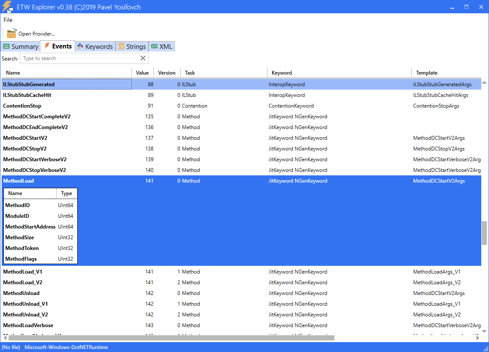

# EtwExplorer
View ETW Provider metadata

Event Tracing for Windows ([ETW](https://docs.microsoft.com/en-us/windows/win32/etw/event-metadata-overview)) is a logging facility built into the Windows OS. Modern providers register a manifest that describes all the events they support, with their properties. Classic providers register a MOF instead.

ETW Explorer attempts to show these events with a simple GUI.



## Requirements

- Windows 10/11 (the app is WPF and reads provider metadata through ETW and WMI)
- [.NET 11 SDK](https://dotnet.microsoft.com/download/dotnet/11.0) to build, or the .NET 11 Desktop Runtime to run a published build
- Visual Studio 2026 (optional) with the **.NET desktop development** workload

## Building

```powershell
dotnet build EtwExplorer.sln -c Release
dotnet run --project EtwExplorer
```

The solution contains two SDK-style projects targeting `net11.0-windows`:

| Project | Description |
|---------|-------------|
| `EtwManifestParsing` | Library that turns a registered provider's manifest XML, or a classic MOF provider's WMI `EventTrace` class tree, into an `EtwManifest` model |
| `EtwExplorer` | WPF front end (MahApps.Metro + Prism.Core) |

Shared build settings (version, nullable reference types, implicit usings) live in `Directory.Build.props`; code style is defined in `.editorconfig`.

